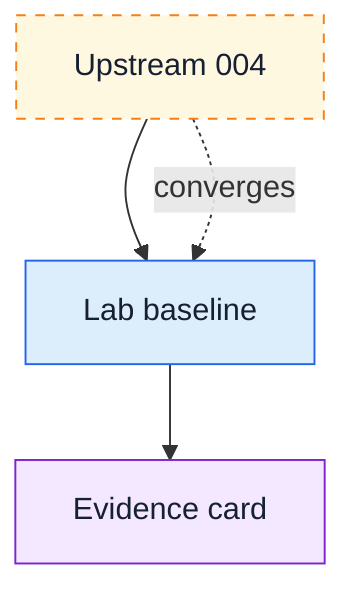

# Learning paths

Prefer a convergence state: 004/C0, 007/C1, 009/C2 or 012/C3. These combine exploration tracks into integrated demos and starting points. Choose another upstream state for a specific need; 004 is not a prerequisite. See [team setup and state selection](../participating.md#2-choose-your-starting-state). The path below is the provided 004 evidence-card example, linking its pinned upstream baseline to Lab-owned experiments. Upstream implementation status is distinct from local runtime verification. Lab states remain planned until their runtime gates pass.

State | Learning Guide | Spec Pack | Generated Branch | Diff vs Previous | Runnable
--- | --- | --- | --- | --- | ---
004-containerized-compose-runtime (upstream) | [Pinned guide](https://github.com/finos/traderX/blob/56c458457e35f32215500a03a3c320c92801567a/docs/learning/state-004-containerized-compose-runtime.md) | [Pinned spec](https://github.com/finos/traderX/blob/56c458457e35f32215500a03a3c320c92801567a/specs/004-containerized-compose-runtime/spec.md) | [Upstream branch, moving](https://github.com/finos/traderX/tree/code/generated-state-004-containerized-compose-runtime) | Upstream containerization | Not verified in Lab
lab-004-baseline | [Guide](lab-004-baseline.md) | [Spec](../../specs/lab-004-baseline/spec.md) | Planned; unpublished | No functional delta | Not verified
lab-005-evidence-card | [Guide](lab-005-evidence-card.md) | [Spec](../../specs/lab-005-evidence-card/spec.md) | Planned; unpublished | Evidence worksheet only | Not verified
