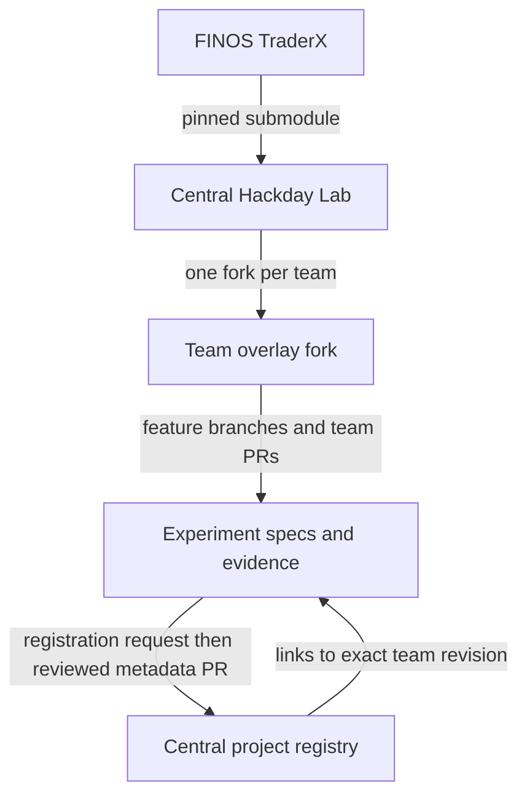

# How your team works

**Fork the Hackday Lab overlay once per team.** This gives you the starter, state catalog, specs, transforms and portal tooling. You do not need to fork FINOS TraderX or deploy a team website to participate.

This is still a prototype: the runtime rehearsal and automated registry publication gates are incomplete. You can prepare your experiment and submit an early registration request; a request does not yet create a published project card.

The starter source lives on the central repository’s `main` branch. Record the exact starter commit your team forks; runtime and registry readiness remain governed by the evidence gates.

## Which repository does what?

| Repository | Purpose | How you use it |
| --- | --- | --- |
| FINOS TraderX | Canonical architecture, states and generation machinery | Pinned Git submodule at `upstream/traderX`; leave it unchanged |
| Central Hackday Lab overlay | Shared starter, challenges, learning paths and reviewed registry | Fork once per team; submit registration metadata here |
| Your team fork | Your specs, transforms, experiment states and evidence | Teammates collaborate through normal branches and PRs |



**Participant repositories are not submodules.** The central portal needs reviewed metadata and links, not every team's code checkout. Only upstream TraderX is a submodule. Registering your work does not grant permission to execute your scripts, and it does not merge your implementation into the central overlay.

## 1. Fork and clone

Use **Fork** on the [Hackday Lab repository](https://github.com/DovOps/example-finos-traderx-hackday-portal), selecting your team organization or one teammate's account. Give teammates access to that fork. Replace `YOUR-TEAM` below with its owner:

```sh
git clone --recurse-submodules https://github.com/YOUR-TEAM/example-finos-traderx-hackday-portal.git
cd example-finos-traderx-hackday-portal
git remote add lab https://github.com/DovOps/example-finos-traderx-hackday-portal.git
git switch -c experiment/your-team-evidence-card
```

`origin` is your team fork. `lab` is the central overlay. The nested `upstream/traderX` repository has its own remote and pinned revision. If you cloned without submodules, run `git submodule update --init --recursive`.

When the starter changes, fetch `lab`, merge the agreed starter changes into your team branch, and resolve them normally. Keep your upstream pin intentional; do not run a submodule update that tracks a moving branch without reviewing and retesting it. Follow [the contribution rules](https://github.com/DovOps/example-finos-traderx-hackday-portal/blob/main/CONTRIBUTING.md), including DCO sign-off on every commit.

## 2. Choose your starting state

**Prefer a convergence state as your jumping-off point, unless your experiment needs something specific from another state.** Convergence states bring several exploration tracks back together into a combined demo/state, giving teams an integrated foundation to extend. Any upstream state is still eligible; you do not have to start at 004 or complete earlier hackday exercises first. Forking the team repository and choosing an architectural starting state are separate decisions: a Git fork preserves the source, while the selected state defines the system you extend.

Browse the portal’s **States & learning** page (recommended convergence states are shown by default; select **All upstream + Lab states** to explore other starting points), then read your chosen state's pinned learning guide, spec and prerequisites. The pinned upstream catalog marks these recommended convergence points:

| Convergence | State | Starting capabilities |
| --- | --- | --- |
| C0 | 004 — containerized Compose runtime | Compose foundation |
| C1 | 007 — observability with LGTM | Observable service stack |
| C2 | 009 — order management and matcher | Integrated trading workflow |
| C3 | 012 — platform convergence | Combined platform foundation |

Choose the convergence point that fits your needs and available resources, not automatically the highest number. Convergence is architectural integration, not proof of a successful local runtime rehearsal. Upstream records convergence contributions separately from the single-parent generated-branch ancestry; they are not extra Git merge parents.

For a specific capability, other states may be a better fit:

| Your experiment needs | Consider upstream state |
| --- | --- |
| A Compose starting point | 004 — containerized Compose runtime |
| PostgreSQL or NATS | 005 — PostgreSQL, or 006 — NATS |
| Observability or market data | 007 — LGTM, or 008 — pricing and streaming |
| Order management and matching | 009 — order management and matcher |
| Kubernetes, Tilt or platform work | 010–013 — choose the relevant platform state |
| Desktop intent interoperability | 014 — FDC3 |

These are pointers, not a claim that every state is a linear superset or that the event has verified each runtime. Inspect the actual parent graph and contracts. Earlier states 001–003 are equally valid when they fit your question.

Tell the operators your chosen **state ID + full upstream commit SHA**, required services/tools, resource needs and intended change. They can help allocate ports, namespaces and support. Registration welcomes exploring projects from any starting state; runtime readiness is recorded separately.

### The provided 004 example


Read [tooling](tooling.md), [the baseline guide](learning/lab-004-baseline.md) and [runtime rehearsal](planning/runtime-rehearsal.md). For the provided evidence-card exercise, generate its 004 baseline:

```sh
bash pipeline/generate-state.sh lab-004-baseline --dry-run
```

This creates the layout without starting services. Build/start and inherited behavior checks are separate gates. Check the current [evidence status](planning/gates.md) before presenting the starter as working.

### Other upstream states

The Lab wrapper currently dispatches only `lab-004-baseline` and `lab-005-evidence-card`; it does **not** generate arbitrary upstream IDs. For another state, use the pinned upstream generator in a separate working checkout so its generated docs and layout do not modify the overlay’s submodule:

```sh
# From your team overlay checkout; use a new sibling directory.
TEAM_UPSTREAM_PIN=$(git -C upstream/traderX rev-parse HEAD)
git clone upstream/traderX ../team-traderx-work
git -C ../team-traderx-work checkout --detach "$TEAM_UPSTREAM_PIN"
cd ../team-traderx-work
# Example only: choose the actual ID from the pinned catalog.
bash pipeline/generate-state.sh 009-order-management-matcher
```

Read that state's guide and tool requirements before generation. The upstream command is not the Lab `--dry-run` wrapper. Follow the selected state's own generated build/start/check/stop instructions; the Lab runtime wrapper is scoped to the provided example. Keep generation outputs isolated per checkout and do not run concurrent generations into a shared output directory.

Keep durable experiment specs, transforms and reproduction commands in your team fork. Record the working checkout revision and how your changes are applied after generation. General team-state dispatch remains planned; an exploring registration can link to your guide and evidence without that dispatch being implemented centrally.

Use the event pin when it contains your chosen state. If you need a different upstream revision, coordinate it with operators and record the exact SHA and pinned source links in your project. The central portal's pin remains independent; a different revision must be displayed explicitly, never silently represented as the event baseline.

## 3. Make an experiment in your fork

Choose one challenge and a starting state. Reserve a team-qualified ID, such as `lab-orbit-evidence-card`, so different teams do not collide. That ID is illustrative; the current generator only supports the two built-in Lab states. General scaffolding and generation dispatch for arbitrary team states remain backlog work.

Keep your durable changes in:

- `specs/<state-id>/`: specification, plan, tasks and system contracts.
- `overlay/transforms/`: idempotent changes applied after generated layout copy.
- `catalog/state-catalog.json`: lineage, ownership, pin and generated-branch metadata.
- `docs/learning/<state-id>.md`: walkthrough, observations and limitations.
- `hackday/project.yaml`: proposed project metadata for registration.

Use normal team PRs for review. Do not treat hand-edited files under `generated/` as your source; regeneration replaces them. Do not edit canonical upstream packs for event-specific behavior.

## 4. Record the work while it is happening

You can register an **exploring** project before it succeeds. Describe the question, starting state, current revision and next steps. Add demonstrations or reproduction evidence later. Negative findings are welcome; a docs build does not prove runtime success.

Read [Register and update your project](registration.md) for the request format and the publication process. A team-hosted portal is optional: a README or learning guide in your fork is sufficient for the initial link-out model.

## 5. Choose what to contribute

There are three separate PRs, with different purposes:

| PR | Destination | Required to share a project? |
| --- | --- | --- |
| Team implementation review | Your team fork | Use your team's normal review process |
| Registry metadata | Central Hackday Lab | Required for a reviewed portal listing once publication is enabled |
| Reusable overlay or upstream improvement | Central overlay or FINOS TraderX | Optional; separate review and acceptance |

A useful experiment does not need to merge into the central overlay or graduate upstream. Your code stays in your fork; the portal links to the reviewed evidence.
