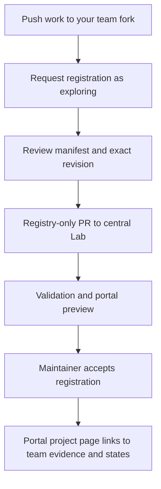

# Register and update your project

**Register the work, not just the finished demo.** An exploring project can have a question, a starting state and a work-in-progress guide. A successful experiment, team website or implementation merge is not a prerequisite.

## What you can do today

Submit a **project registration request** using the button on Projects & teams. It opens a GitHub issue in the central Lab repository; you review the text and submit it yourself. Include:

1. A stable team/project ID and a short title and summary.
2. Your team repository URL and the full 40-character commit SHA from `git rev-parse HEAD` after pushing your work.
3. Any upstream starting state ID, full upstream commit SHA, pinned guide/spec links and any experiment state IDs. Include required tooling/services and whether you need operator help; 004 is not a registration prerequisite.
4. A guide or README, evidence links if available, limitations and next steps.
5. A maintenance contact; include personal profiles only with their explicit consent.

The request is an organizer review queue. **It does not automatically add a card to the portal.** The current build intentionally rejects nonempty registry data until remote-ref, manifest, consent and evidence validation are implemented. Do not bypass that check to publish a project.

## Intended publication workflow



The automated validation, PR preview and project-page ingestion steps are planned. Until they pass, requests can be discussed and prepared but are not published listings.

## Project metadata in your fork

Prepare `hackday/project.yaml`. The participant-manifest schema is still being finalized; the following is a **design example**, not a validated manifest template:

```yaml
schemaVersion: 1
id: team-orbit-example
title: Evidence-card experiment
summary: Learn how to record a reproducible TraderX experiment.
teamId: orbit-example
event: prototype-2026
repository: https://github.com/YOUR-TEAM/YOUR-REPOSITORY
owner: YOUR-GITHUB-LOGIN
startingState: 004-containerized-compose-runtime
upstreamPin: REPLACE_WITH_FULL_UPSTREAM_SHA
experimentStates:
  - lab-orbit-evidence-card
status: exploring
guide: docs/learning/lab-orbit-evidence-card.md
evidence: []
limitations:
  - Runtime checks have not passed yet.
nextSteps:
  - Demonstrate inherited booking behavior.
contributors: [] # Add only consented public details.
license: Apache-2.0
attribution:
  - Based on FINOS TraderX and the Hackday Lab overlay.
```

Use your actual project ID and license; retain upstream attribution and identify any additional content licenses. Keep the team commit SHA in the **central registration entry**, not as the manifest's own SHA: editing a manifest to contain its own commit hash would change that hash again.

## Starting-state lineage

Prefer a convergence state (004/C0, 007/C1, 009/C2 or 012/C3), unless your experiment needs a specific exploration state. `startingState` may still name **any state in TraderX at `upstreamPin`**, including later states such as 009 or 014. Record why the chosen state fits your experiment; this recommendation is not a registration restriction. The 004 YAML above is only an example. Identify your experiment's actual immediate parent(s) in its state catalog; do not insert a fictional 004 Lab parent. A team-qualified state ID and its project/revision distinguish experiments from different forks.

Reviewers resolve the starting-state ID against the catalog at the declared upstream SHA. If that differs from the event pin, the intended listing must show both revisions and link to the team's pinned upstream sources, rather than incorrectly linking to an event state page with different content. Unknown states or unavailable revisions need clarification; later state numbers do not. Record support needs and unverified runtime status independently of registration eligibility.

The local Lab catalog validator accepts parents from all states in the event's pinned upstream catalog. Different-pin team projects remain external registry references; they must not be added to the event catalog as though they shared its pin. Automated remote lineage validation and project rendering are still pending with the other publication gates.

## Central registry entry

Once publication gates are available, create a normal branch in your fork based on the central Lab's current default branch. Add **only the registration entry** to the central registry through a PR; do not include your experiment implementation commits in that PR. Append to `projects` in `registry/projects.json` without replacing existing projects:

```json
{
  "id": "team-orbit-example",
  "repository": "https://github.com/YOUR-TEAM/YOUR-REPOSITORY",
  "revision": "REPLACE_WITH_THE_PUSHED_40_CHARACTER_COMMIT_SHA",
  "manifest": "hackday/project.yaml",
  "level": "registered"
}
```

This is a placeholder example; replace it with real values before validation. The [registry-entry schema](../schemas/registry.schema.json) defines the implemented structural contract. The registry entry's SHA points at the version of your manifest, specs and evidence being reviewed.

The intended portal result is a project card and detail page showing your idea, team repository, reviewed revision, parent and experiment states, guide, evidence, limitations and status. Each team state links back to its project. A listing is a reviewed reference, not an endorsement or a hosted TraderX runtime.

## Keep your listing current

Push a new revision to your fork and request an update with the new SHA and a short account of what changed. Once registry publishing is enabled, updates use another reviewed registry PR. Moving your team's branch does not silently update accepted portal evidence.

- **Exploring:** a described experiment, including unfinished work.
- **Demonstrated:** a linked demonstration at a recorded revision.
- **Reproducible:** independent reproduction evidence, not just a passing documentation build.
- **Maintained / archived:** ownership and lifecycle information.

An event snapshot keeps its accepted revisions frozen. Later work can have a separate continuation link. Ask maintainers for corrections, profile removal or archival through the same project discussion.

## Why not participant submodules?

A registry entry keeps the central portal lightweight and makes review boundaries explicit. It can link to many forks without checking out or executing their code. Only the canonical TraderX generator is a pinned submodule. An optional featured snapshot can later preserve approved, bounded documentation/images with attribution; it is a separate step from ordinary registration.
